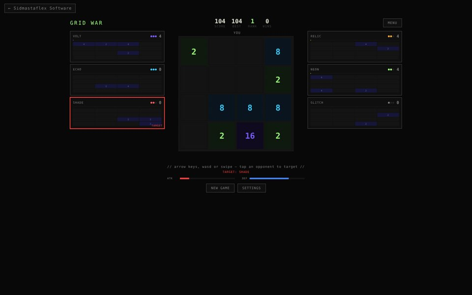

# Grid War

A battle-royale take on 2048, playable in the browser. You face six computer opponents of different skill levels; merging tiles charges an attack meter that drops junk tiles on whoever you target, Tetris 99-style. Last board standing wins.

**Play it:** https://sidmastaflex.com/projects/grid-war/

## Features

- Battle mode (you vs. 6 NPCs) and classic Solo mode
- Click or tap any opponent to target them; attack and defense meters
- NPC skill levels from near-random to near-optimal
- Win-streak crowns that persist across games
- Four synthesized sound packs and four visual themes (Acid, Riddim, Pipeman, Fastguy), mix and match
- Demo shop with a simulated unlock (no real payments)
- Keyboard (arrows / WASD) and touch swipe controls, responsive down to phone width

## Tech

Single self-contained HTML file: vanilla JavaScript, CSS custom-property themes, Canvas particles, and the Web Audio API for all sound (no audio files). No build step and no dependencies; open `index.html` in any browser.

Built by [Siddhanth Sharma](https://sidmastaflex.com/software.html).
